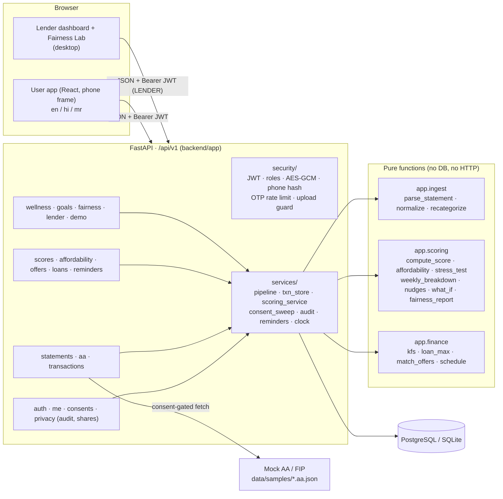
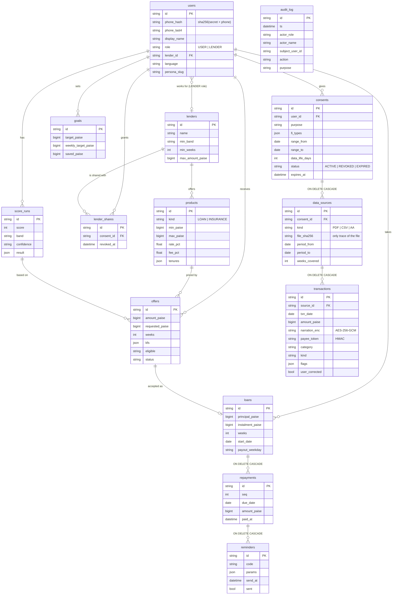
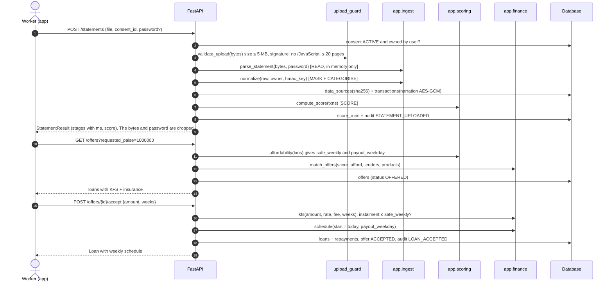

# SahayakFin architecture

A React phone-frame app and a desktop lender/fairness view talk to one FastAPI service (`/api/v1`). The service owns
auth, consent, storage, security and audit, and calls a **pure, unit-tested** Python package for parsing, scoring and
loan maths. Nothing in the API computes a score itself. Data lives in PostgreSQL (SQLite for development).

## 1. Components

The frontend's Vite dev server proxies `/api` to port 8000, so requests are same-origin. CORS is limited to
`FRONTEND_ORIGIN` as a second guard.

## 2. Data model (CONTRACTS §6)

Money is `BIGINT` paise everywhere. JSON columns use the generic SQLAlchemy `JSON` type so the same models run on
SQLite and PostgreSQL (`python -m pytest` passes on both). `audit_log` is insert-only and has no foreign key, so the
diary survives data deletion.

## 3. Upload → score → offers → accept

## 4. API

All routes are under `/api/v1`. Errors are always `{"error": {"code", "message"}}`. Auth is `Authorization: Bearer <jwt>`
except where marked "public".

| Method | Path | Who | Purpose |
| --- | --- | --- | --- |
| GET | `/health` | public | Liveness |
| POST | `/auth/otp/request` | public | Demo OTP (5 per minute per phone) |
| POST | `/auth/otp/verify` | public | Login, creates the user if new → JWT |
| GET / PATCH | `/me` | user | Profile + flags `has_active_consent`, `has_score`, `has_loan` / language |
| POST / GET | `/consents` | user | Create (purpose, range, data life) / list |
| POST | `/consents/{id}/revoke` | user | Revoke → delete sources + transactions, end shares |
| POST | `/aa/fetch` | user | Simulated Account Aggregator fetch for a demo persona |
| POST | `/statements` | user | Upload PDF (also locked) or CSV |
| GET | `/transactions?weeks=12` | user | Masked transactions grouped by week |
| PATCH | `/transactions/{id}` | user | Change category → rescore |
| POST | `/scores` | user | Recompute score |
| GET | `/scores/latest` | user | Latest score (`consent_revoked: true` after revoke) |
| POST | `/scores/what-if` | user | Effect of one tip |
| GET | `/affordability` | user | Safe weekly instalment, loan max per tenure |
| POST | `/affordability/stress` | user | Income-drop test (10/20/30%) |
| GET | `/offers` | user | Matched loan offers with KFS + sachet insurance |
| POST | `/offers/{id}/accept` | user | Accept → loan + weekly schedule |
| GET | `/loans` | user | Loans with live repayment status |
| POST | `/repayments/{id}/pay` | user | Pay one instalment |
| GET | `/reminders` | user | Sent reminders (chat order) |
| GET | `/wellness/weekly?weeks=4` | user | Weekly spending by category + nudges |
| POST / GET | `/goals` | user | Savings goal |
| GET | `/audit` | user | "Who saw my data" (last 50) |
| GET | `/lenders` | user | Lenders + current share id |
| GET / POST | `/shares` | user | Active shares / share score summary with a lender |
| DELETE | `/shares/{id}` | user | Stop sharing |
| GET | `/lender/applicants` | LENDER | Score summaries of users who shared (audited per view) |
| PUT | `/lender/rules` | LENDER | Change rules → eligible before / after |
| GET | `/fairness/report` | public | Fairness tests on synthetic personas (cached 10 min) |
| POST | `/demo/advance-clock` | user, DEMO_MODE | Move the simulated clock 1–30 days |
| POST | `/demo/reset` | user, DEMO_MODE | Delete the caller's data, reset the clock |
| GET | `/demo/samples/{persona}.{csv,pdf,locked.pdf}` | public | Synthetic sample files |

Interactive docs: `http://localhost:8000/docs`.

## 5. Security controls mapped to DPDP Act 2023 principles

We claim alignment with the principles, not certification.

| DPDP principle | Control in SahayakFin | Where | Tested by |
| --- | --- | --- | --- |
| Notice and consent | Consent object with purpose, date range, data life and fetch type, shown in plain language (en/hi/mr) before any data is read. No upload or AA fetch without an ACTIVE consent owned by the user. | `api/consents.py`, `services/pipeline.py` | `test_no_consent`, `test_revoked_consent_blocks_upload`, `test_revoked_consent_blocks_aa_fetch` |
| Purpose limitation | The only purpose is `LOAN_ASSESSMENT`. Lenders see a score summary only, and only after a per-lender share. | `schemas.ConsentIn`, `api/lender.py` | `test_consent_validation`, `test_lender_sees_only_summary_keys` |
| Data minimisation | The raw file is never stored, only its SHA-256. Account numbers, phones and UPI handles are masked. Names become HMAC payee tokens. Phones are stored as a salted hash + last 4. `TxnOut` never returns the payee token or balance. | `ingest.normalize`, `services/txn_store.py`, `security/hashing.py` | `test_transactions_grouped_and_masked` |
| Storage limitation | Data life of 1–90 days. Consents past `expires_at` become EXPIRED on the next request and their data is deleted. | `services/consent_sweep.py` | `test_expired_consent_deletes_data`, `test_advance_clock_past_data_life_expires` |
| Right to erasure | Revoke deletes data sources and transactions (DB cascade), ends lender shares, and returns the deleted counts. | `api/consents.py` | `test_revoke_returns_counts_and_audits`, `test_full_flow` |
| Security safeguards | AES-256-GCM narrations; JWT HS256 with role checked against the DB; role guards; 404 (not 403) on other users' ids; OTP rate limit; upload size, signature, script and page checks; PDF password used once and never logged; logs contain no bodies or personal data; CORS limited to the frontend. | `security/*`, `main.py` | `test_api_security.py`, `test_api_upload.py` |
| Accountability | Insert-only audit log for consent, upload, recategorise, loan, repayment, share and every lender view, shown to the user. | `services/audit.py`, `GET /audit` | `test_full_flow`, `test_lender_sees_only_summary_keys` |

## 6. Data lifecycle

| Stage | What happens | Where the data is |
| --- | --- | --- |
| Collect | The user gives consent, then uploads a statement or triggers the mock AA fetch | Request memory |
| Validate | Size ≤ 5 MB, `%PDF-` or UTF-8 CSV signature, extension matches, no `/JavaScript` `/JS` `/Launch` `/EmbeddedFile`, ≤ 20 pages | Request memory |
| Parse in memory | `parse_statement` decrypts a locked PDF in memory with the one-time password | Request memory; the password is dropped after |
| Mask | Account numbers, phones and UPI handles are masked; names become `P-XXXXXXXX` HMAC tokens; categorised before masking | Request memory |
| Encrypt + store | Narration encrypted with AES-256-GCM; only the file's SHA-256 is kept | `data_sources`, `transactions` |
| Score | Pure engine over stored, masked transactions | `score_runs` (kept as a lending record) |
| Share summary | Per-lender share; the lender sees band, score, confidence, reason codes and safe weekly amount, under an `APP-XXXX` reference | `lender_shares`; each view goes to `audit_log` |
| Delete | Revoke or expiry deletes sources → transactions and ends shares; `/demo/reset` clears everything for the user | Gone. The audit row records it. |

## 7. Running

See `README.md`. Short version: `cd backend && uvicorn app.main:app --reload --port 8000`, and
`python -m app.seed --reset` before a demo.
